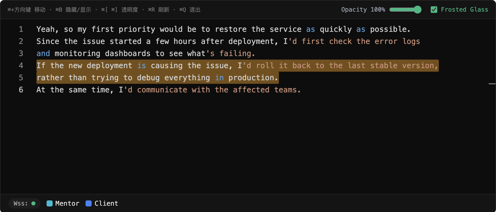
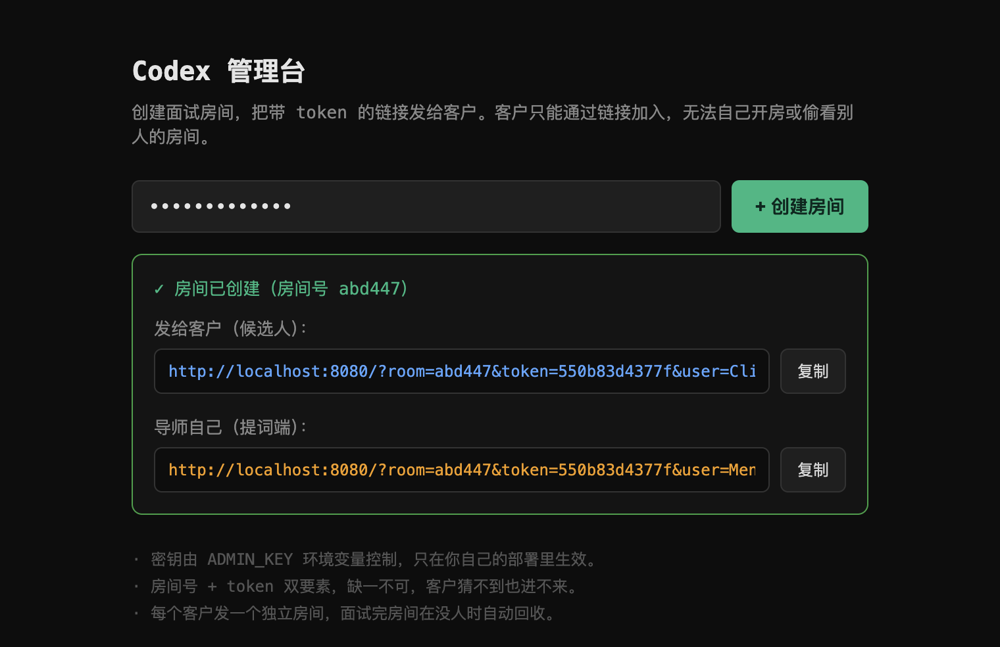
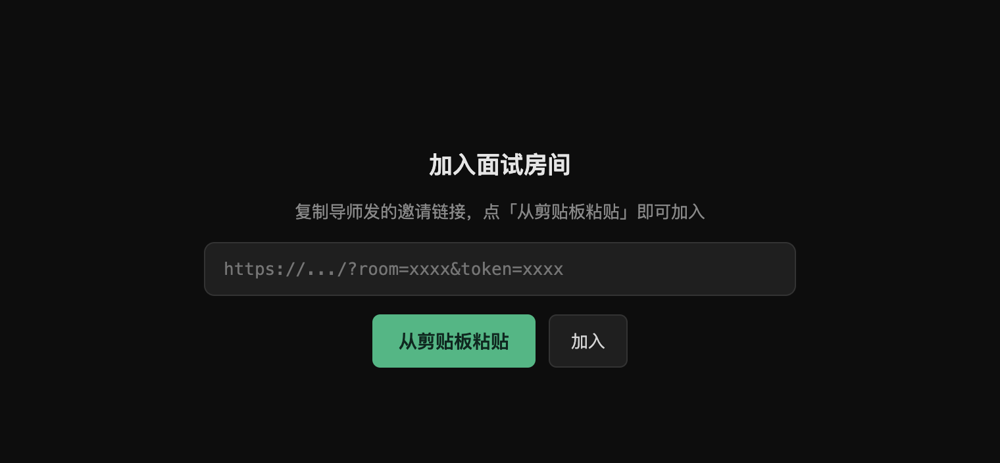
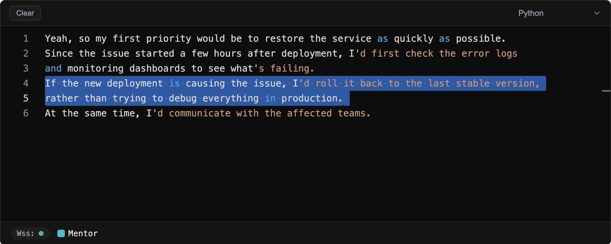

#Glasspad

导师在网页端打字，候选人在桌面 App 里实时看到。候选人的 App 是一个可调透明度的悬浮窗，置顶显示在浏览器上方，内容只读。



## 功能

- **实时同步**：导师逐字输入，候选人端即时显示，超过一屏时自动滚到最新一行。
- **选区同步**：导师选中的文字，在候选人端显示为橙色高亮，用来指出重点。
- **只读**：候选人端不能修改内容。
- **选中改色 / 加粗**：导师选中一段文字后，点顶栏「选中字色」的色点改颜色（最左侧彩点清除颜色），点「B」或按 `⌘B` / `Ctrl+B` 加粗（再按一次取消）。只影响选中部分，候选人端实时同步显示。候选人端没有改色和加粗的入口。
- **透明悬浮窗**：透明度 8% 到 100% 可调，可以透过窗口看到下面的浏览器；可开 Frosted Glass 毛玻璃模糊背景。
- **邀请链接加入**：房间由管理员创建，每个房间有独立 token，没有链接进不了房间。
- **房间持久化**：服务重启后房间和 token 仍然有效，房间闲置 6 小时后回收。

## 使用流程

### 1. 导师创建房间

打开管理台 `https://你的域名/admin`，输入 `ADMIN_KEY`，点「创建房间」。页面给出两条链接：蓝色发给候选人，黄色自己用。



### 2. 候选人加入

候选人打开桌面 App，复制邀请链接后点「从剪贴板粘贴」。



### 3. 导师打字

导师用浏览器打开自己的链接，直接在编辑器里输入。`Clear` 清空双方屏幕，右上角切换语法高亮（BQ 面试的英文回答用 Plain Text，避免 `I'd` 这类缩写被当成字符串染色）。



## 候选人 App 快捷键

| 快捷键（Windows 用 Ctrl） | 作用 |
|---|---|
| `⌘` + 方向键 | 移动窗口（每次 40px） |
| `⌘B` | 隐藏 / 显示窗口 |
| `⌘[` / `⌘]` | 降低 / 提高透明度 |
| `⌘R` | 刷新 |
| `⌘Q` | 退出 |

窗口不支持鼠标拖动：在 macOS 上拖动窗口会激活应用，面试平台可能把它识别成切换应用，所以只用快捷键移动。

**透明度怎么调**

- 想看清下面浏览器里的题目：关掉 Frosted Glass，透明度调到 20% 到 35%。
- 下面的页面太花、影响看字：打开 Frosted Glass，透明度调到 60% 到 80%。

## 安装候选人 App

到 [GlassPad Releases](https://github.com/hphphpcat/glasspad/releases/tag/glasspad) 下载最新版本：

- macOS（Apple Silicon）：`GlassPad-<版本>-arm64.dmg`
- Windows（x64）：`GlassPad-<版本>-portable.exe`，免安装，双击运行

安装包没有签名：

- **macOS**：把 App 拖进「应用程序」后，如果提示「已损坏」，在终端运行一次：
  ```bash
  xattr -cr /Applications/Codex.app
  ```
- **Windows**：SmartScreen 提示时点「更多信息」→「仍要运行」。

## 部署服务端

服务端是一个 Node 进程，同一个端口提供页面、WebSocket 和建房接口。仓库自带 `Dockerfile` 和 `railway.json`，可以直接部署到 Railway。

**必须设置的环境变量**

| 变量 | 说明 |
|---|---|
| `ADMIN_KEY` | 管理台密钥。生产环境不设置时服务拒绝启动。 |
| `DATA_DIR` | 房间数据目录。Railway 上挂一个 Volume 到 `/data`，并设为 `/data`，否则重启后房间丢失。 |

部署好后，修改 `electron/main.js` 里的 `startUrl` 为你的域名，再打包候选人 App。

## 本地开发

```bash
npm install
npm run build             # 构建前端到 dist/
node server/index.js      # 服务端 http://localhost:8080，管理台 /admin，开发密钥 dev-admin-key
npm run electron          # 启动候选人 App（连本地需设置 ELECTRON_START_URL=http://localhost:8080/）
```

**打包**

```bash
npm run dist              # macOS dmg
npm run dist:win          # Windows x64 便携版
```

**测试**（先启动服务端）

```bash
node scripts/sync-test.mjs        # 鉴权 + 打字同步
node scripts/empty-room-test.mjs  # 房间清空后 token 仍有效
npx electron scripts/screenshots.js  # 重新生成 README 截图
```

## 发版流程

改完代码后按下面的顺序发版。只执行 `git push` 不会出现新的 Release：仓库没有 GitHub Actions，安装包要在本地打包后上传。

**约定**

- 远程 `origin` 有两个 push 地址（`hphphpcat/codex-clone` 和 `hphphpcat/glasspad`），`git push origin` 会同时推送两个仓库。
- 安装包统一放在 `hphphpcat/glasspad` 的一个 Release 里，tag 固定叫 `glasspad`。每个版本往里追加附件，并把标题改成 `GlassPad v<版本>`。
- `server/index.js` 的默认下载链接按 `releases/download/glasspad/GlassPad-<版本>-arm64.dmg` 和 `GlassPad-<版本>-portable.exe` 拼接，附件文件名必须一致，否则客户端的「完整安装包更新」会下载失败。

**步骤**（`X.Y.Z` 为新版本号）

1. 升版本号，以下三处保持一致：`package.json` 的 `version`；`server/index.js` 的 `pkgVersion` 初值、兜底值和 `appRelease.notes` 更新说明；`src/App.jsx` 里 `performUpdateCheck` 的 `currentVersion`。
2. 验证：
   ```bash
   npm run build
   node --check server/index.js
   ```
3. 提交并推送：
   ```bash
   git add <改动文件>
   git commit -m "feat: ... (vX.Y.Z)"
   git push origin main
   ```
4. 打安装包，输出到 `release/`：
   ```bash
   npm run dist                               # macOS arm64 DMG
   npx electron-builder --win portable --x64  # Windows 便携版
   ```
5. 打 tag 并推送，`glasspad` tag 每次都强制移动到最新提交：
   ```bash
   git tag vX.Y.Z HEAD
   git tag -f glasspad HEAD
   git push origin vX.Y.Z
   git push -f origin glasspad
   ```
6. 上传安装包并更新 Release 标题（token 从 `GITHUB_TOKEN` / `GH_TOKEN` 或 git 钥匙串读取）：
   ```bash
   node scripts/upload-release.mjs "更新说明 1" "更新说明 2"
   ```
7. 核验 Release 标题是 `GlassPad vX.Y.Z`，且两个安装包都在：
   ```bash
   curl -s https://api.github.com/repos/hphphpcat/glasspad/releases/tags/glasspad \
     | node -e "const d=JSON.parse(require('fs').readFileSync(0,'utf8'));console.log(d.name,(d.assets||[]).map(a=>a.name).filter(n=>n.includes('X.Y.Z')))"
   ```

## 目录

```
server/index.js      服务端：静态页、WebSocket 房间、建房接口、房间持久化
src/App.jsx          导师网页端 + 候选人 App 共用的页面（按是否运行在 Electron 区分）
src/Admin.jsx        管理台
electron/main.js     候选人 App 窗口：透明、置顶、防截屏、快捷键
electron/preload.js  暴露给页面的桌面能力（毛玻璃、剪贴板）
scripts/             测试、截图与发版上传脚本（upload-release.mjs）
```
